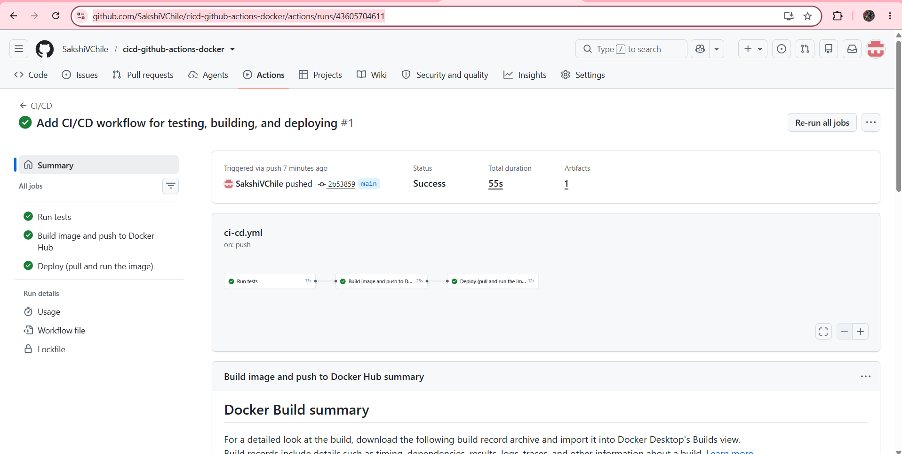
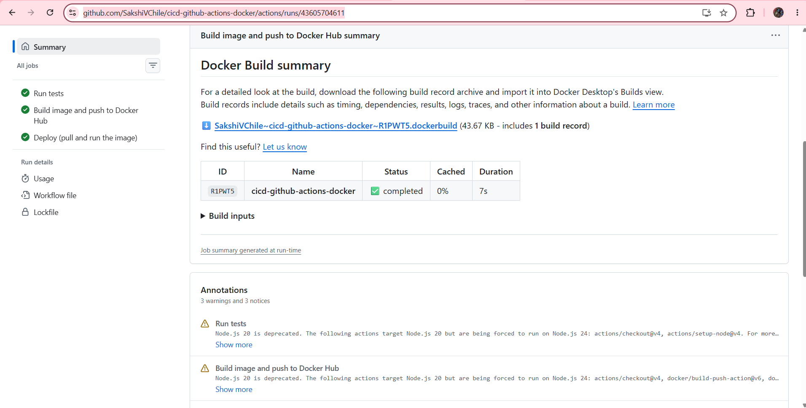
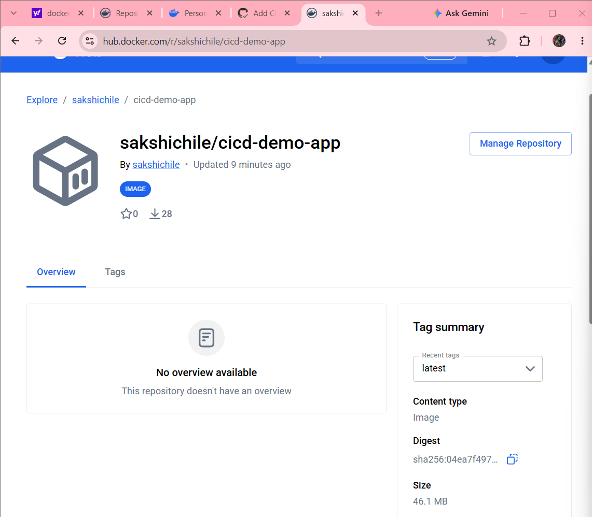

# CI/CD Pipeline with GitHub Actions & Docker

**Elevate Labs DevOps Internship - Project 4: CI/CD Pipeline with GitHub Actions & Docker**

A full CI/CD pipeline that runs the tests, builds a Docker image, pushes it to Docker Hub and then pulls and runs it, automatically on every push to `main`. No cloud account is needed.

- **Docker image:** https://hub.docker.com/r/sakshichile/cicd-demo-app
- **Pipeline runs:** https://github.com/SakshiVChile/cicd-github-actions-docker/actions

## Pipeline flow

```
git push to main -> Run tests -> Build image & push to Docker Hub -> Deploy (pull & run, health check)
```

| Job | What it does |
| --- | --- |
| **Run tests** | Checks out the code, sets up Node.js 20 and runs `npm test`. If a test fails, the pipeline stops and nothing is built. |
| **Build image and push to Docker Hub** | Logs in to Docker Hub, builds the image from the `Dockerfile` and pushes it with two tags: `latest` and the Git commit SHA. |
| **Deploy (pull and run the image)** | Pulls the image back from Docker Hub, runs the container on port 3000 and checks `/health` until the app responds. The job fails if the app does not become healthy. |

Pull requests to `main` run only the tests; building and deploying happen only on a push to `main`.

## The app

A small Node.js HTTP server (no dependencies):

| Route | Response |
| --- | --- |
| `GET /` | `{"message":"Hello from the CI/CD pipeline!","version":"<commit SHA>"}` |
| `GET /health` | `{"status":"ok"}` |
| anything else | `404` |

The `version` is the Git commit that built the image, so the running container shows which commit it came from. There are 3 unit tests (`npm test`).

## Project structure

```
.
├── .github/workflows/ci-cd.yml   # the pipeline
├── src/app.js, src/server.js     # the app
├── test/app.test.js              # unit tests
├── Dockerfile                    # builds the image
├── docker-compose.yml            # runs the app locally
├── .dockerignore, .gitignore
└── screenshots/                  # proof that the pipeline ran
```

## Dockerfile highlights

- Small base image: `node:20-alpine`.
- Installs only production dependencies (`npm install --omit=dev`).
- Receives the commit SHA as a build argument (`APP_VERSION`).
- Has a `HEALTHCHECK` that calls `/health`.
- Runs as the non-root `node` user.

## Secrets

The workflow logs in to Docker Hub with two **GitHub Actions secrets** (Settings -> Secrets and variables -> Actions): `DOCKERHUB_USERNAME` and `DOCKERHUB_TOKEN`. The token is a Docker Hub access token with Read & Write permission, not my password, and it never appears in the code or the logs.

## How to run the image yourself

With Docker installed:

```bash
docker run -p 3000:3000 sakshichile/cicd-demo-app:latest
# open http://localhost:3000   (and /health)
```

or build and run it from this repo:

```bash
docker compose up --build
```

## Screenshots

**1. Pipeline succeeded (Run tests -> Build and push -> Deploy)**



**2. Docker build summary from the build-and-push job**



**3. Image published on Docker Hub**



## Notes and changes from the suggested guide

The guide suggests pulling and running the image on Minikube or a local VM. My PC has no Docker or VM, and my free Codespaces quota was used up, so I ran the deploy step on the GitHub-hosted runner instead: the job pulls the image from Docker Hub, starts the container and verifies it with a health check. The same image runs on any machine with `docker run` or `docker compose up`.

## Interview questions

**1. What is a DevOps pipeline, and how do you set it up?**
A pipeline is an automated sequence of stages that takes code from a commit to a running application. I set it up as a GitHub Actions workflow (`.github/workflows/ci-cd.yml`) with three jobs: test, build and push, deploy.

**2. What is the difference between continuous integration, continuous delivery and continuous deployment?**
CI automatically builds and tests every change that is merged. Continuous delivery keeps the code always ready to release, with a manual approval for production. Continuous deployment releases automatically when the checks pass. My pipeline does CI (tests and build) and also deploys automatically.

**3. What is containerization, and how is it different from virtualization?**
A container packages an app with its dependencies and shares the host's kernel, so it is small and starts in seconds. A virtual machine runs a full guest operating system on a hypervisor, so it is heavier and slower to start.

**4. What is Docker, and how does it work?**
Docker builds images from a `Dockerfile` and runs them as isolated containers using the host's Linux kernel features (namespaces and cgroups). Images are stored in a registry such as Docker Hub.

**5. What is the use of Docker Compose?**
It describes one or more containers, their ports and settings in a single `docker-compose.yml` and starts them with one command (`docker compose up`).

**6. How do you manage secrets in a pipeline?**
I keep them out of the code and store them in GitHub Actions secrets, read as `${{ secrets.NAME }}`. I use an access token instead of a password, with the minimum permissions, and I can delete or rotate it at any time.

**7. How do you implement security in a CI/CD pipeline?**
Least-privilege tokens, secrets storage, running the container as a non-root user, a small base image, and running tests before anything is built or deployed. More checks can be added, such as image vulnerability scanning and dependency scanning.

**8. What is a rollback, and how would you do it here?**
A rollback returns to the last good version. Every image is also tagged with its commit SHA, so I can run an older version again by pulling `sakshichile/cicd-demo-app:<old-sha>` and starting it.

**9. What are some popular CI/CD tools you have worked with?**
Jenkins (my earlier task, with a Jenkinsfile) and GitHub Actions (this project). Both define the pipeline as code in the repository.
